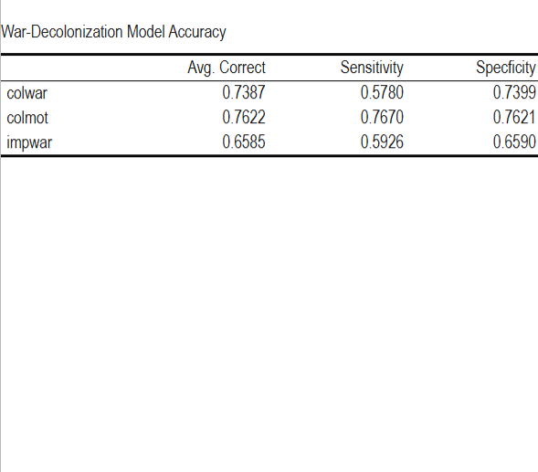
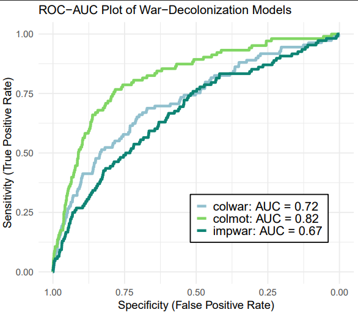

# Exploring War, Decolonization, & Factors of Independence 	
Within this repository are the data sources and R script for my project *Exploring War, Decolonization, & Factors of Independence*, the final project of a course in risk modeling for political science. All data sources are publically accessible. Contact me [here](https://github.com/weinsteinabi#contact-information) to discuss the project further. 

This project was completed on December 15th, 2025. It was added to this profile on June 4th, 2026. 

## 🗒️ Project Overview
This project, overseen by Professor Joseph Wright of Pennsylvania State University, was an exploration of the varying roles state-sanctioned violence played on the success of colonial independence movements. We asked whether or not war involvement of either the colony or imperial power in some capacity influenced instances of decolonization amongst those colonies. To do address this, we utilized a country-year style dataset containing information for 120 countries from 1817 to 1989. These years were selected as the bookends for the age of "New Imperialism" and the eras that followed. This period is characterized by an exapansion of colonial efforts made by former colonies themselves before gradually giving way to the imperial motives of WWII and the Cold War. 

Using this data, we created three logistic regression models controlling for geographic and demographic factors that address three different aspects of war: war involvement of the occupied territory, the *type* of war engaged in, and war involvement of the imperial power. Models are evaluated using results from _k_-fold cross validation techniques. Model fit and accuracy is presented in the form of specificity, senesitivity, and AUC obtained from reciever operating characteristic (ROC) curve calculations. 

## 🧮 Data Sources
Below is a list of all data sources utilized in this project. Data files exist in this repository in the [data sources folder](https://github.com/weinsteinabi/war_decol/tree/main/data_sources) for most sources. For those that are not (in italics), links will be included to the sources. 

- **Conflict Data**: obtained from the [Correlates of War Project](https://correlatesofwar.org/data-sets/cow-war/), specifically from their 2010 versions of data. Contains data from inter- (v.4.0), intra-(v.5.1), and extra-state (v.4.0) conflicts.
- **Colony Data**: pulled from two sources, the [Colonial Dates (COLDAT) Dataset](https://dataverse.harvard.edu/dataset.xhtml?persistentId=doi:10.7910/DVN/T9SDEW) and Andreas Wimmer's ["From Empire to Nation-State" dataset](https://www.awimmer.com/data).
- ***Control Data***: obtained from the [Varieties of Democacy v15 complete dataset](https://v-dem.net/data/the-v-dem-dataset/country-year-v-dem-fullothers-v15/). 
- **Supplementary Population Data**: obtained from [World Population Review](https://worldpopulationreview.com/about), contained in three .csv files containing data for the years 1800, 1900, and 1989.
- ***Supplementary Geographic Data***: obtained from [public web sources](https://en.wikipedia.org/wiki/List_of_countries_and_dependencies_by_length_of_coastline) to supplement missing data from Wimmer's datasets. 

The **final** dataset is found separate from these files. 

## 💻 R Script Navigation
All scripts for data cleaning and modeling can be found [here](https://github.com/weinsteinabi/war_decol/tree/main/scripts), in the scripts folder of the repository. Each is titled with the data they primarily work with. Please note that these scripts are in the process of being refined for use beyond my own system. 
- *war.R*: processes conflict data from the Correlates of War and Andres Wimmer's dataset to extract war data on a yearly level for all countries. This includes identifying when wars begin, when they are active, what kind of wars are occurring, and how many are occurring within/being participated in by each country present in the data. It creates two data frames which will be used upon merging, one for colonies and another for occupying forces. 
- *colonization.R*: identifies which countries are occupied by whom at a particular time, as well as duration of occupation for each country in the dataset. 
- *controlchar.R*: processes control variable data for each country observed. This includes data regarding democratic presence in government, population, coastlines, and region.
- *merge.R*: this file takes data processed in the three files above and combines it into a colony-country dyadic dataset for every year that colony is occupied. This introduces the *decolonized* flag and lags all conflict and control data presented as to provide us with the means to predict decolonization instances using the previous year's conflict information.
- *datadescription.R*: produces summary tables and visuals to identify relationships between key variables.
- *modeltests.R*: builds our three models and performs *k*-fold cross-validation to determine model accuracy.
## 🥼 Methodology
### Data Processing
Data was expanded to have an observation per year of occupation. Observations that fell outside the date range of 1817 to 1989 were excluded. In order to accurately develop our models, we must first engage in some degree of data processing. These is perhaps the most tedious portion of the project, as we are combining and restructuring five data sets. To properly do this, we need to ensure that naming and coding is consistent across countries and conflicts. This was done manually for our conflict data, as there was a change in coding procedure during the time period some datasets were created. Flags for the following events were also created: 
- war: binary, indicates an active war in that country-year
- war onset: binary, marks start year of a conflict
- war type: categorical, indicates interstate (1), extrastate (2), or intrastate (3) conflict
- colony: binary, indicates the existence of the territory as a country or colony (1 = colony)
- decolonized: binary, indicates whether a decolonization event occurred that year
  
A sum of the total wars engaged in by each country in an observation was also calculated. War time data was split into two data sets, one to be used as the basis for colony data and another to be used as colonizer data. The same was done with our control characteristics. The colony and decolonized flags were used to remove countries from the data set after the gained independence. In some cases, countries did reenter the data set.

With the expansion complete and each needed dataset created, the merge was possible. The first merge combined colony records and colony characteristic data. Colonizer characteristic data was added following this, which contained only the democracy score of the occupying nation. Conflict data relevant to the occupying nation, the number of conflicts engaged in annually, was attached. Finally, conflict data relevant to the colonies themselves were added. This included the war onset, war, and war type flags. All characteristic and war data was lagged such that for each yearly observation, data is from the year prior.  Colony data (colony and decolonized flags) is for the year listed in the observation. 

### Modeling and Validation
The models themselves were all logistic regression variables aimed at accurately identifying instances of decolonization (or "independence events") based on varying conflict scenarios. Three models in total were constructed: 
1. **Colony War Model**:The first model identifies instances of decolonization using war engagement of occupied territory as the primary predictor, controlling for logged population and region metrics. This is our base model.
2. **War Motivations Model**: The second model focuses on what kind of conflict the occupied territory was engaged in (interstate conflict, civil war, etc.) while controlling for population, global region, as well as the democracy score of the *occupying* nation.
3. **Colonizer War Model**: The final model shifts from exploring independence events based on situations of the colony to exploring motivations of an imperial power to "allow" for independence. This is done through accounting for resource availability of the colony (evaluated through coastline and mountainous regions) and the number of conflicts the imperial power has been engaged in throughout the past year. 

The constructed models were then evaluated through repeated *k*-fold cross validation. In this instance, *k* = 5, with the process repeated ten times. Through this, each observation in the dataset could be assigned an average probability of being classified as a decolonization event for each model. These values were then used to create a Receiver-Operator Curve for each model from which AUC values could be drawn. Specificity, sensitivity, and accuracy were also identified provided the threshold of *t* = .0076, the mean occurrence of decolonization within the data.
## ▶️ Project Outcomes and Future Steps

When evaluated at the previously mentioned threshold, all models indicate fairly strong predictive power, with an average accuracy of around 70% regardless of event occurrence. More nuanced analysis indicates that the *Colony* War model and the *Colonizer* War model  are mostly random when it comes to correctly predicting the instances of decolonization event, with sensitivity (true positive rate) not breaking 60% at our established threshold. Our War Motivations model was correct 75% of the time at the sample threshold. 

  

Model fit, as evaluated by the AUC of the ROC curve, supports these findings on more general level. All models have suitable AUCs, but the War Motivations model has the best with an AUC of .82, indicating a high TPR (sensitivity) across infinite thresholds. This is likely due to the inclusion of democracy metrics in the model. Further exploration should be done with this model to identify the scale of impact democracy metrics and war have on the decolonization events, as it is likely that both have prominent influences that are both being considered in the general outcome of the model. 

  

Future directions include further developing these models with a more stable theoretical base and examining coefficients of the models upon repeated training to identify scale of influence and significance to our dependent variable. 

## 📝 Citations
1) Coppedge et al. (2025). V-Dem [Country-Year/Country-Date] Dataset v15. Varieties of Democracy (V-Dem) Project. https://doi.org/10.23696/vdemds25. Accessed Nov. 15, 2025. 

2) Sarkees, Meredith Reid and Frank Wayman. (2010). Resort to War: 1816 – 2007. Washington DC: CQ Press. Accessed Nov. 27, 2025.

3) Becker, Bastian. (2019). Colonial Dates Dataset (COLDAT), https://doi.org/10.7910/DVN/T9SDEW. Harvard Dataverse, V3. Accessed Nov. 21, 2025. 

4) Wimmer, A., \& Min, B. (2006). From Empire to Nation-State: Explaining Wars in the Modern World, 1816-2001. American Sociological Review, 71(6), 867–897. http://www.jstor.org/stable/25472435. Accessed Nov. 15, 2025. 
